<p align="center">
  
</p>

<h1 align="center">Focus Timer</h1>

<p align="center">A small focus/rest timer that lives in the macOS menu bar.</p>

## What it does

- **Dial timer.** Pick a focus or rest length by dragging a 60‑minute dial, in 5‑minute steps.
- **Menu bar countdown.** While running, the menu bar shows a capsule with a shrinking pie and the time left. Idle, it shows a small dial wound to 45 minutes.
- **You decide when to switch.** When a session ends the timer stops, plays a ding, posts a notification with a one‑tap *Start rest* / *Start focus* action, and blinks the menu bar until you react. Nothing starts on its own.
- **History.** Today's focus total and the list of sessions. A day runs from 06:00 to 05:59; sessions under 5 minutes are ignored.
- **Your colors.** Focus and rest colors are configurable and apply to the dial, the menu bar and the history card.
- **Launch at login**, **optional menu bar countdown**, **ding volume**.

English and Korean interface, following the system language.

## Install

1. Download the latest `Focus-Timer-*.zip` from [Releases](../../releases) and unzip it.
2. Move **Focus Timer.app** to `/Applications`.
3. The app is not notarized. On first launch, right‑click the app and choose **Open**, then confirm. (Or run `xattr -d com.apple.quarantine "/Applications/Focus Timer.app"` once.)

Requires macOS 11 or later.

## Build from source

```bash
git clone https://github.com/oeo30/TomatoBar.git
cd TomatoBar
xcodebuild -project TomatoBar.xcodeproj -scheme TomatoBar -configuration Release \
  -derivedDataPath build CODE_SIGN_IDENTITY="-" CODE_SIGNING_REQUIRED=NO CODE_SIGNING_ALLOWED=NO build
open "build/Build/Products/Release/Focus Timer.app"
```

Or open `TomatoBar.xcodeproj` in Xcode and run the `TomatoBar` scheme.

## Automation

The timer can be toggled from the command line or Shortcuts:

```bash
open focustimer://startStop
```

## Credits

Focus Timer is a reworked fork of [TomatoBar](https://github.com/ivoronin/TomatoBar) by Ilya Voronin.
The timer sound is licensed from [buddhabeats](https://www.buddhabeats.net/).

Dependencies: [LaunchAtLogin](https://github.com/sindresorhus/LaunchAtLogin), [SwiftState](https://github.com/ReactKit/SwiftState).

## License

MIT. See [LICENSE](LICENSE). Copyright © 2022–2023 Ilya Voronin, © 2026 oeo30.
